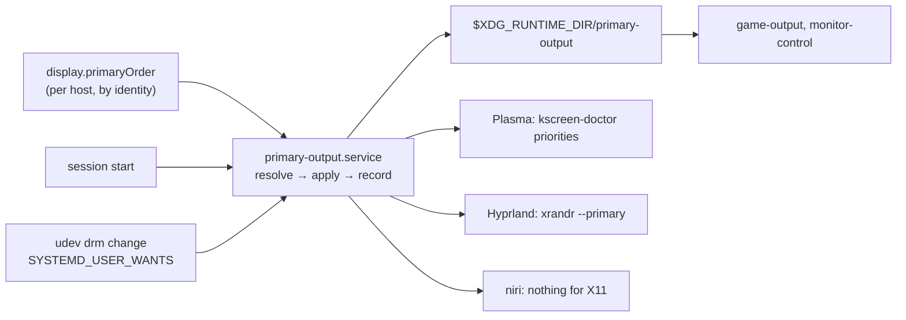

# Primary output: one declared preference, applied by every desktop

> **Current design:** the last addendum, "four reviews (2026-11-14)", supersedes
> the design below and the earlier addenda wherever they disagree. Read it first;
> the rest is kept for the reasoning and the rejected paths.

## Goal

A host declares which monitor should be "primary" in order of preference, by
the monitor's identity, and every desktop it runs (Plasma, Hyprland, niri)
makes the first connected one primary, again on every hotplug. Docked, zephy's
big external monitor wins; undocked, the laptop panel does, with no manual step.

"Primary" is what decides:

- where Proton/Wine games open (they read X11's primary through Xwayland);
- where noctalia shows notifications on Hyprland and niri;
- where Plasma puts its primary panel, notifications and SDL games;
- `monitor-control`'s workspace target and `game-output`'s fallback output.

## Non-goals

- Following the mouse or focus per game launch (rejected below).
- Choosing a monitor per game.
- Monitor layout, modes or positions: `display.monitors` and the compositors
  keep that job; this only ranks outputs.
- Where native Wayland games open on Hyprland and niri: they use the order the
  compositor announces outputs, which nothing here can change.
- The login screens (SDDM, noctalia-greeter): they run before the session and
  keep reading the static `primary` flag.

## Background

Core Wayland has no primary output (`wl_output` has no such concept;
[sway#5758](https://github.com/swaywm/sway/issues/5758) proposed one in 2020
and it never landed). Each desktop has its own, or none:

| Desktop | Primary today | Who sets X11's primary |
|---|---|---|
| Plasma | Output priority, saved per monitor set ("setup") in `kwinoutputconfig.json` | KWin, from priority 1, on every output-order change and every RandR event (`Xwayland::updatePrimary()`, `src/xwayland/xwayland.cpp`) |
| Hyprland | None | Nobody. Xwayland defaults to the output nearest 0,0; `xrandr --primary` sticks until that output is hot-plugged, when Xwayland recreates it and drops the flag ([ArchWiki: Sway](https://wiki.archlinux.org/title/Sway), [kyouha.today](https://kyouha.today/blog/rando/xwayland-game-primary-monitor/)) |
| niri | None | xwayland-satellite, which calls `SetOutputPrimary` for the output of the X11 window it focuses (`src/xstate/mod.rs`) |

Wine builds its display list from X11's primary and falls back to output 0
without one. Plasma also exports its order to KDE clients and SDL through
`kde-output-order-v1`.

### Current state in this repo

`display.monitors.*.primary` is a static bool, read by:

- `home/common/optional/desktops/common/wayland-wm/personal/noctalia/default.nix`:
  `notification.monitors` on desktops (laptops get all monitors);
- `home/common/optional/desktops/hyprland/_common/monitor-control.nix`:
  where workspaces go;
- `home/common/optional/gaming/steam/game-output.nix`: fallback output;
- `hosts/common/optional/nixos/services/display-managers/`: SDDM's KWin layout
  and noctalia-greeter.

It fails on laptops: zephy's external monitor is not in `display.monitors` (its
connector moves between DP-2 and DP-4 across boots), so the flag can only name
the laptop panel.

## Design



### 1. The preference: `display.primaryOrder`

A list of monitor matchers, most preferred first, in `modules/common/monitors.nix`:

```nix
display.primaryOrder = [
  {description = "<make> <model>";}   # zephy's external monitor, any port
  {description = "AU Optronics 0x8E9D";}
];
```

- Matched on make + model (optionally serial), the same text Hyprland's `desc:`
  uses, never on connector.
- No match connected: the internal panel (`eDP-*`), else the first output.
- Default: the `display.monitors` entries with `primary = true`, then the rest in
  list order, so hosts that set nothing behave as today.

### 2. The trigger

- `primary-output.service`, a home-manager user unit, `PartOf` and `After`
  `graphical-session.target`, so it runs once per login.
- A host udev rule on `SUBSYSTEM=="drm", ACTION=="change"` with
  `ENV{SYSTEMD_USER_WANTS}="primary-output.service"` restarts it on hotplug. One
  trigger for every compositor; niri has no output event in its IPC stream.
- Oneshot, debounced: a dock emits several change events, and compositors are
  briefly unresponsive mid-reconfigure, so it waits about a second and retries.

### 3. Resolve → apply → record

One script, three steps:

1. **Resolve:** read connected outputs from the running compositor (chosen by
   `XDG_CURRENT_DESKTOP`): `kscreen-doctor -j`, `hyprctl monitors -j`,
   `niri msg -j outputs`; pick the first `primaryOrder` match.
2. **Apply**, per compositor:
   - **Plasma:** `kscreen-doctor output.<n>.priority.1 output.<m>.priority.2 …`
     for every output (setting only one leaves duplicate priority 1s; see
     [KDE bug 521211](https://bugs.kde.org/show_bug.cgi?id=521211)). KWin then
     saves it into the current setup and updates Xwayland.
   - **Hyprland:** `xrandr --output <n> --primary` on Xwayland's display.
   - **niri:** nothing for X11, because xwayland-satellite overwrites primary on
     every X11 focus change. Only the recorded state applies.
3. **Record:** write the connector to `$XDG_RUNTIME_DIR/primary-output`, which
   `game-output` and `monitor-control` read instead of the static flag.

### 4. noctalia

Its `notification.monitors` takes connectors, fixed at build time. Two shapes,
undecided (open question 1): keep it as is (laptops already get all monitors),
or let the service rewrite noctalia's override file and run
`noctalia msg config-reload`.

## Alternatives considered

- **Follow the mouse at launch** (`game-output` sets priority, or a KWin script
  moves the window): moves Plasma's panels and notifications on every launch,
  and moving a Wine window after the fact leaves Wine on the old mode when
  monitor resolutions differ ([prefixr#85](https://github.com/firsttris/prefixr/pull/85)).
- **Patch KWin's `updatePrimary()` to follow focus:** a KWin rebuild on every
  bump, Plasma only.
- **Wine's Wayland driver with `WAYLANDDRV_PRIMARY_MONITOR`:** per game, and the
  driver doesn't run every game.
- **Set it by hand per setup in Plasma's Display settings:** works on Plasma,
  which remembers it per setup, but covers neither Hyprland nor niri, and isn't
  in nix.
- **kanshi or shikane profiles with an `exec` hook:** they manage layouts, which
  we don't want from them; KWin doesn't speak their protocol; and their hooks
  start without `DISPLAY` and need retries
  ([hyprmoncfg#56](https://github.com/crmne/hyprmoncfg/issues/56)). The udev
  trigger costs less.
- **Replace `monitors.*.primary` outright:** touches the login screens, which
  run before any session; kept as the static default instead.

## Open questions

1. noctalia: rewrite its override and reload at runtime, or leave notifications
   as they are?
2. The identity format each source reports: `kscreen-doctor -j` (does it carry
   make/model, or only an EDID hash?), `hyprctl` `description`, `niri msg`
   `make`/`model`/`serial`. One normalised string is needed.
3. Plasma: should a primary picked by hand in Display settings win until the
   next hotplug, or should nix always win?
4. niri: is satellite's focus-follows behaviour acceptable, or do we want to
   pin X11's primary there too (needs satellite to stop overwriting it)?
5. demon runs Hyprland, niri and Plasma: the service must pick the running
   compositor, not the installed ones.

## Risks

- Hotplug storms during docking: debounce plus retry; a wrong pick self-corrects
  on the next event.
- The user unit lacks session variables (`DISPLAY`, `HYPRLAND_INSTANCE_SIGNATURE`)
  unless they are imported into the systemd user environment.
- KWin's duplicate-priority bug, if it reappears with every output set.
- A primary that changes under a running game: only new launches follow it.

## Addendum: review (2026-11-14)

An independent review of the design above. This addendum supersedes the
sections it names.

### Verified against the repo

- **Hyprland already sets X11's primary, and it fails on zephy.**
  `hyprland/_common/settings.nix:119` runs
  `xrandr --output ${primaryMonitor.output} --primary` in `exec-once`. zephy's
  `output` is `desc:AU Optronics 0x8E9D`, which xrandr cannot resolve, so it does
  nothing. The Hyprland mechanism exists; it needs the `desc:` resolved to a
  connector and re-applying on hotplug.
- **noctalia's monitor already changes at runtime.** `hyprland/sunshine.nix:100`
  writes a drop-in (`NOC_DROP_IN`) with `[notification] monitors = [...]`.
  Open question 1 is answered: reuse that drop-in.
- **More consumers of `.primary` than listed:** `gaming/steam/hyprland.nix:21`
  (Steam toast window rule), `hyprland/sunshine.nix:11`, and
  `gaming/steam/default.nix:12`, plus the five in "Current state".
- **The identity concept already exists.** zephy declares monitors as
  `desc:<make> <model>`, so the external monitor can be declared too; its moving
  connector is not a reason for a second identity scheme.
- **xwayland-satellite follows focus:** it calls `SetOutputPrimary` with the
  focused X11 window's output (`src/xstate/mod.rs`, read during research).

### Changes to the design

- **Plasma: no runtime code.** KWin already remembers priority per setup, and
  `kwinoutputconfig.json` persists on zephy. Rewriting priorities on every event
  would fight KWin's own restore and any manual pick. Pick it once per setup in
  Display settings.
- **Hyprland: fix what exists, then re-apply on hotplug.** Resolve `desc:` to a
  connector with `hyprctl monitors -j` and listen to Hyprland's socket2
  `monitoradded`/`monitorremoved` events instead of udev. The `SYSTEMD_USER_WANTS`
  trigger is unproven for `change` events on a device unit that's already active,
  and Hyprland's own events need no host rule.
- **niri: accept focus-follows.** It already does what this design wanted for
  games launched from the focused monitor.
- **The preference:** declare every monitor in `display.monitors` (with `desc:`)
  and rank them, rather than adding `primaryOrder` beside it.
- **Ignore `HEADLESS-*` outputs,** which Sunshine creates and which would trigger
  churn.
- **Shape follows "features own their adapters"** (`desktop-layers/design.md`): a
  Hyprland-only listener, not one script dispatching on `XDG_CURRENT_DESKTOP`.
- **Tests:** a bats suite resolving primary from captured `hyprctl` JSON fixtures.

### Still open

1. How to rank: an integer `priority` on `display.monitors`, or list order? The
   external monitor would then need declared width/height/refresh, which
   `display.monitors` requires; or those become optional for monitors that only
   rank.
2. `game-output`'s HDR lookup keys on `m.output`, which is `desc:…` on zephy and
   never matches a connector. It needs the same resolution step.
3. Which static consumers move to the runtime choice (`monitor-control`, Steam's
   toast rule, `game-output`'s fallback) and which keep the build-time flag (SDDM,
   the greeter).

### Unverified

- That a udev `change` event can start a user unit through `SYSTEMD_USER_WANTS`
  (now moot for Hyprland, but relevant if niri or Plasma later need a trigger).
- The `kscreen-doctor` priority syntax and KDE bug 521211's current state.

## Addendum: a rule, not a list (2026-11-14)

Supersedes "The preference" in the review addendum. A laptop meets monitors no
config can list (a friend's screen, a hotel TV, a work projector), so declaring
every monitor breaks at the first unknown one.

### The rule

For any set of connected outputs, ignoring `HEADLESS-*`:

1. Internal panels are `eDP-*` and `LVDS-*`; everything else is external.
2. An external output beats an internal one.
3. Among externals, the most pixels wins; ties break on connector name, so the
   pick never flips between hotplugs.
4. With no external, the internal panel marked `primary` in `display.monitors`
   (zephy has two internal panels), else the first internal.

### Pins

A host may rank specific monitors by identity (`desc:<make> <model>`) to
override the rule, for example a small desk monitor that should never be
primary. Undeclared monitors fall to the rule. Desktops with fixed monitors keep
the static `primary` flag and need no rule.

### Per desktop

- **Hyprland:** the listener applies the rule on every `monitoradded` /
  `monitorremoved`.
- **Plasma:** KWin keeps its per-setup memory. Unknown: what KWin picks for a
  setup it has never seen. If that default is wrong, the rule applies only to new
  setups, and manual picks win after that.
- **niri:** unchanged; satellite follows focus.

### Deferred

Remembering a manual override per set of connected monitors on Hyprland, as KWin
does. Added only if the rule proves not enough.

### Open

- The tie-breaker among several externals: most pixels, leftmost, or highest
  refresh.

## Addendum: four reviews (2026-11-14)

Four independent reviews attacked the rule above: real-world scenarios,
upstream fact-check, simpler alternatives, failure modes. This addendum is the
current design.

### Facts settled (upstream source, read 2026-11-14)

- **Hyprland:** Xwayland names outputs by connector (`DP-4`), so
  `xrandr --output DP-4 --primary` is valid. Removing the primary output clears
  the flag (`RROutputDestroy` → `primaryOutput = NULL`), and a re-added output
  comes back non-primary. `monitoraddedv2>>ID,NAME,make model serial` (commas
  stripped) can fire before Xwayland has created the output.
- **KWin:** a never-seen setup keeps the saved priority of the closest known
  partial setup and appends new outputs in DRM order
  (`outputconfigurationstore.cpp` `generateConfig`). A laptop panel seen alone
  before stays primary when an unknown external appears, so Plasma does need
  the rule, once per new setup. `kscreen-doctor output.<name>.primary`
  renumbers every output itself (libkscreen `adjustPriorities`); the
  duplicate-1 bug (KDE 521211) is a KWin resume bug, not a kscreen-doctor one.
- **xwayland-satellite:** sets primary to the output of the focused X11 window,
  and to **none** when a Wayland window has focus. A game launched from a
  Wayland launcher on niri then gets Wine's output-0 fallback.
- **noctalia v5.5:** `notification.monitors` takes connectors **or description
  tokens**, falls back to all monitors when none match, and reloads `*.toml`
  drop-ins by inotify. `follow_focused_output` exists.
- **Internal panels can't be found by connector name:** zephy's bottom panel is
  `DP-3`, a Zephyrus Duo on NVIDIA showed `DP-0`/`DP-2`, freya's dGPU panel is
  `eDP-2`, and there is no generic sysfs "internal" flag.

### Selection, revised

"Most pixels wins" is gone: a 4K TV or a projector would take primary from the
desk monitor. "Every monitor declared" was already gone. What's left needs no
list of external monitors:

1. **Candidates:** enabled outputs only (a TV that is off or on another input
   but still enabled is a known gap). Ignore `HEADLESS-*` and outputs that
   mirror another.
2. **Internal:** the host's declared `display.monitors` entries (`desc:`); a
   connector prefix (`eDP`/`LVDS`/`DSI`) only for hosts that declare none.
3. **Sticky:** if the current primary is still a candidate, keep it. Docking
   storms and unrelated hotplugs then change nothing.
4. **Otherwise:** an external beats an internal; among externals, the one with
   focus, else a stable order by identity (`make model serial`), never by
   connector.
5. **No external:** the internal entry marked `primary`.
6. **Optional pins:** a host may mark known monitors `never-primary` (a TV,
   a projector) or preferred, by `desc:`. Nothing is required.

### Shared pieces

- **One resolver**, `desc:` → connector, used by every consumer:
  `hyprland/_common/settings.nix` (its `xrandr` line passes `desc:` today and
  fails silently), `game-output` (its HDR lookup never matches on zephy),
  `monitor-control`, `sunshine.nix`. It fails loudly when nothing matches. This
  fixes real bugs today and comes first.
- **A record** of the pick and the rule that chose it, written atomically, with
  `--explain` to print the candidates.

### Per desktop

- **Hyprland:** a listener on socket2 `monitoraddedv2`/`monitorremovedv2`,
  debounced about 2 s, applies with `xrandr --primary`, reads it back, and retries
  with backoff, logging each attempt. With only `HEADLESS-*` present (Sunshine) it
  does nothing, and it never writes Sunshine's noctalia drop-in. It reconnects to
  a fresh socket after a Hyprland restart or resume and reconciles on every
  connect. It is installed only by the Hyprland home module, so demon's Plasma
  and niri sessions never run it.
- **Plasma:** apply the selection once per setup KWin has not seen, with a single
  `kscreen-doctor output.<name>.primary`; after that KWin's memory and manual
  picks win.
- **niri:** nothing; satellite follows focus. Accept the Wayland-launcher gap.

### Phases

1. The resolver, fixing the four `desc:` consumers. Useful on its own.
2. The Hyprland listener.
3. Plasma's new-setup apply.

### Tests (bats, fixtures fed to the real scripts)

- Resolver: `desc:` → connector on captured `hyprctl -j monitors` JSON,
  including DP-2/DP-4 swapped; no match fails.
- Selection: zephy undocked (two panels); docked plus a TV with a never-primary
  pin; sticky current primary; Sunshine-only outputs → no `xrandr` call.
- Listener: a stub `xrandr` that fails twice then succeeds; a fake socket that
  closes and is reconnected.

### Still open

1. Plasma: how to know a setup is new. Compare against `kwinoutputconfig.json`'s
   setups, or keep our own record of seen sets?
2. Notifications on laptops: keep all monitors, follow the primary through a
   drop-in (without colliding with Sunshine's), or `follow_focused_output`?
3. Before phase 2, reproduce once on zephy that a replug really drops the flag
   (`xrandr --listmonitors` after unplugging and replugging the external).

### Rejected by the reviews

- **Only fixing the startup `xrandr` line:** fixes zephy at login, not after
  docking, and not Plasma.
- **A short list of known monitors as the preference:** fails on any monitor
  not in the list, which is the laptop case.
- **One generic service dispatching on `XDG_CURRENT_DESKTOP`:** against "features
  own their adapters"; each desktop's piece lives with that desktop.
