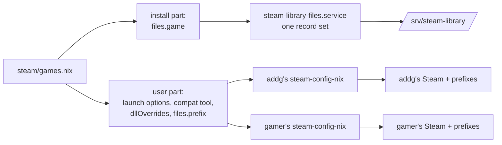

# Shared Steam library: the host owns what lives in it

## Goal

On a host with `gaming.steam.sharedLibrary`, everything Nix writes inside the
library has exactly one writer, so that:

- it is applied whether either user, both, or nobody has signed in, with or
  without autologin;
- removing a setting from the config reverts it, whoever placed it;
- a game installed after a rebuild still gets its files.

Driving case: rig-pc, where `addg` and `gamer` share `/srv/steam-library` and
Automobilista 2 carries a ReShade setup (`dxgi.dll`, shaders, `ReShade.ini`,
preset) in its install folder.

## Non-goals

- Per-user ReShade looks. Files in the install folder are shared by design; a
  per-user look would need a per-user layer such as vkBasalt.
- Changing single-user hosts. Without a shared library, each user's
  steam-config-nix keeps writing everything, as today.
- Libraries other than the shared one on a shared-library host (a user's own
  library). See open questions.

## Current state

Each user's steam-config-nix runs at activation as a user service, reads that
user's Steam folder, and writes:

| What | Where on rig-pc | Writers today |
|---|---|---|
| Launch options, compat tool | `~/.local/share/Steam/userdata/…`, `config/config.vdf` | that user |
| Game-folder files (ReShade) | `/srv/steam-library/steamapps/common/<game>/` | every user whose Steam lists the library |
| Branch, language, auto-update | `/srv/steam-library/steamapps/appmanifest_<id>.acf` | every user (unused so far) |
| Prefix files, winetricks | `<library>/steamapps/compatdata/<id>/pfx` | nobody: outside Steam's sandbox that path is the empty root-owned mount point |

Each user keeps its own record of placed files (`$XDG_DATA_HOME/steam-config-nix`).
With two writers, a second user backs up the first user's file as the game's
own; on removal it can restore it, leaving the file unmanaged. Commit
`feat: Automobilista 2 runs H3RUS's ReShade preset on rig-pc…` accepts that.

## Design



### One declaration, two halves

`games.nix` stays the single place a game is described. On a shared-library
host, `steam/default.nix` moves each app's `files.game` out of the
steam-config-nix app and into an internal home option the host reads:

```nix
# home, internal
gaming.steam.libraryFiles = lib.mkOption {
  type = lib.types.attrsOf (lib.types.attrsOf lib.types.anything); # app id → files.game.place
  internal = true;
};
```

The host collects it across users:

```nix
libraryFiles = lib.foldl' lib.recursiveUpdate {} (
  lib.mapAttrsToList (_: hm: hm.gaming.steam.libraryFiles) config.home-manager.users
);
```

Two users declaring different content for the same app and target fail an
assertion that names both.

### The host service

In `hosts/common/optional/nixos/gaming/steam.nix`, when `sharedLibrary` is set:

- **`users.users.steam-library`**: a system user in group `steam-library`.
- **`systemd.services.steam-library-files`**: `Type=oneshot`,
  `User=steam-library`, `UMask=0002`, `StateDirectory=steam-library-files`,
  `Environment=XDG_DATA_HOME=/var/lib/steam-library-files`. Its `ExecStart`
  is a short Python script that imports steam-config-patcher and calls
  `steam_config_patcher.files.apply_file_ops(steam_dir, file_ops, remove_ops)`:
  - `steam_dir` is `/var/lib/steam-library-files/steam`, whose
    `config/libraryfolders.vdf` lists only the shared library;
  - `file_ops` is one `FileOp(app_id, "game", target, source, mode)` per entry
    of `libraryFiles`, from a JSON file in the store.
- **Triggers**: `wantedBy = ["multi-user.target"]`, `restartTriggers` on that
  JSON so every config change reruns it, and `systemd.paths.steam-library-files`
  on `<library>/steamapps` so an install or update reruns it.

`apply_file_ops` keeps steam-config-nix's semantics: `enforce`, `seed` and
`lock` modes, backups of files the game shipped, and revert of entries that
left the config.

### Removal

The service exists on every shared-library host, even when `libraryFiles` is
empty. An empty list still loads the previous record set, so files that left the
config are reverted by the one writer that placed them.

### Permissions

The library is `2770 root:steam-library` with default group ACLs. Files the
service writes are group-writable, so ReShade, running as whichever user plays,
can save `ReShade.ini` and preset changes (`seed` files).

### User side

Each user's steam-config-nix keeps the launch options, compat tool and
`dllOverrides`. For shared-library games, `prefixPath` points at the user's real
prefix, `~/.local/share/steam-library-compatdata/<id>`, the same directory
`steam.nix` binds over `compatdata` inside Steam's sandbox. `files.prefix` and
`winetricks` then follow it.

### Tests

nix-unit, with fake apps and users and no real host:

- the split puts `files.game` in `libraryFiles` on a shared-library host and leaves
  it in the app elsewhere;
- the host union merges identical entries and rejects conflicting ones by name;
- `prefixPath` is set only for shared-library hosts.

A script check runs the service script against a temporary library: place,
then an empty list reverts, then a re-install of the game reruns placement.

## Alternatives considered

| Option | Why not |
|---|---|
| Every user writes (current) | Removal can leave unmanaged files; each user needs Steam to have run once |
| Primary user writes | Fails silently when that user never runs Steam on the host |
| Desktop user writes | Still needs a session at rebuild; gamer does not linger |
| Shared steam-config-nix state directory for all users | Its record set also holds per-user prefix entries, which would collide across users; concurrent activations race |
| vkBasalt, nothing in the install folder | No in-game overlay; presets converted by hand; no depth or multi-pass shaders; X11-only toggle |

## Open questions

- **Importing steam-config-patcher.** The flake exposes
  `packages.<system>.steam-config-patcher`; whether its Python modules can be
  imported (for example through `python3.withPackages` or its `PYTHONPATH`) is
  unconfirmed.
- **Path trigger.** Whether `PathChanged` or `PathModified` on `steamapps/` fires
  for Steam's manifest writes (rename-into-place).
- **Games in a user's own library on a shared-library host.** Moving
  `files.game` to the host drops them for games installed elsewhere. Either keep
  `files.game` in the user app for app IDs not in the shared library (not
  knowable at evaluation time), or accept it.
- **Install-record settings** (branch, language, auto-update) sit in the shared
  `appmanifest_<id>.acf` too. Moving them to the host needs the patcher's
  key-patching code, not `apply_file_ops`; deferred until a game uses them.

## Risks

- `apply_file_ops` is internal to steam-config-patcher. An upstream refactor
  breaks the service; the script check fails at build time, not at runtime.
- The service runs as a non-login user with write access to every game in the
  library. A malicious `files.game` source could overwrite game binaries; the
  sources are Nix store paths from this repo.
- Boot and path-triggered runs reuse the last activation's JSON; a game installed
  before the rebuild that adds its files waits for that rebuild.

## Verification

On rig-pc with nobody signed in after a rebuild:

1. `systemctl status steam-library-files` succeeded, and
   `/var/lib/steam-library-files/steam-config-nix/files.json` lists the AMS2 entries.
2. `dxgi.dll` and the preset sit in the AMS2 folder, owned by `steam-library`.
3. Remove `automobilista-2` from `gaming.steam.reshade`, rebuild: the five
   entries are gone and `files.json` is empty.
4. Uninstall and reinstall AMS2 without rebuilding: the files return.

## Addendum: implementation (2026-10-31)

Supersedes the sections above where they differ.

- **Importing steam-config-patcher** (open question 1): `library-files.py` is built
  with `writers.writePython3` and
  `python3Packages.toPythonModule (callPackage "${inputs.steam-config-nix}/pkgs/steam-config-patcher/package.nix" {})`,
  so it runs on this repo's Python.
- **Path trigger** (open question 2): `PathChanged` watches `IN_CLOSE_WRITE` and
  `IN_MOVED_TO` on a directory (systemd `src/core/path.c`), which covers Steam
  writing or renaming `appmanifest_<id>.acf` into `steamapps/`.
- **No fake Steam dir.** steam-config-nix always searches the Steam dir's own
  `steamapps`, so the service passes the library itself as `steam_dir`.
- **No `restartTriggers`.** The ops JSON is a store path in `ExecStart`, so a
  changed list changes the unit and the switch reruns it.
- **The host takes only `files.game.place`.** `files.game.patch` and `.remove`
  stay with each user's steam-config-nix.
- **`prefixPath` is deferred.** Set for every game on a shared-library host, it
  would also move the prefixes of games in a user's own library. No game uses
  `files.prefix` or `winetricks` yet.
- **Code:** `steam/apps.nix` splits the ops out as `libraryFiles`;
  `gaming/_library-files.nix` merges them across users; `gaming/steam.nix` runs
  `steam-library-files.{service,path}` as the `steam-library` system user.
  Tests: `unit:home:gaming:steam`, `unit:hosts:gaming`, `script:hosts:gaming`.
- **Seed files are group-writable.** steam-config-nix places every file `0644`,
  which left the preset read-only for the player's ReShade. The placer adds group
  write to the `seed` files it owns; `enforce` files keep `0644`.
- **Start limit off.** `startLimitIntervalSec = 0` keeps Steam's repeated manifest
  writes during a download from failing the path unit.
- **Placements on the host path are validated** in `apps.nix` (exactly one of
  `source`/`text`, a known `mode`), since steam-config-nix's submodule no longer
  sees them.

### Migration on rig-pc

At the first switch, each user's steam-config-nix reverts the AMS2 files it
placed. On 2026-10-31 that ran before the service, which then placed every file
fresh with no backups (`had_backup: false` throughout), so no cleanup was needed.
`addg`'s seeded `ReShade.ini` survived the switch unmanaged and was deleted by
hand so the service re-seeds it. Had `gamer`'s revert restored `addg`'s copies
after the service ran, the service would have backed them up as game files; the
cleanup for that case:

```sh
sudo systemctl stop steam-library-files
sudo rm -rf /var/lib/steam-library-files/steam-config-nix
cd "/srv/steam-library/steamapps/common/Automobilista 2"
sudo rm -rf dxgi.dll d3dcompiler_47.dll reshade-shaders ReShade.ini "AMS2 Realistic.ini"
sudo systemctl start steam-library-files
```
