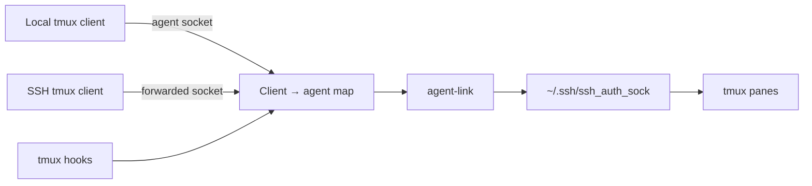

# tmux SSH-agent routing

## Goal

Keep SSH signing functional and identity-safe in long-lived tmux panes as
clients attach, become active, disconnect, or lose their forwarded agents.

## Non-goals

- Inferring whether the user is at a desktop.
- Routing GUI applications or long-lived daemons such as t3code.
- Changing 1Password's approval model.
- Supporting several named tmux servers against one global link.

## Design

tmux refreshes its session environment from the attaching client before the
hooks run. `agent-link attach <client>` records that raw socket, then replaces
the tmux session's `SSH_AUTH_SOCK` with the stable link for future panes.

`client-active` selects the recorded agent belonging to tmux's most recently
active client. `client-detached` removes records for clients tmux no longer
lists and selects the newest survivor.

The router serializes hook runs with `flock` and replaces symlinks atomically.
Before selecting an agent, it verifies that the socket is owned by the user and
answers `ssh-add -l` within a bounded timeout.

## Failure handling

| Failure | Behaviour |
|---|---|
| Client brought no agent | Aim at `.no-agent` and report the refusal |
| Newest agent disappeared | Refuse; do not use an older client |
| Agent accepts but stalls | Timeout, refuse, and report |
| tmux environment cannot be read | Do not record the attaching client |
| tmux clients cannot be listed | Preserve the current link and records |
| Concurrent hooks run | Serialize them or report lock timeout |
| Link cannot be replaced | Report that the old target may remain |

## Process boundaries

Shells outside tmux retain the agent they normally discover: a forwarded agent
for an SSH connection or the host's configured local agent. GUI applications
retain their existing SSH configuration.

t3code is deliberately outside this router. Its systemd server has no tmux
client identity, and its requests can arrive from several frontends. It keeps
its normal startup-time agent discovery rather than inheriting the tmux link.

## Alternatives

### Presence-aware host routing

Desktop login, lock, unlock, and tmux activity could move one host-wide link.
This was rejected because presence cannot distinguish an ignored approval from
a locked or failed agent, and a shared daemon request has no reliable origin.

### Agent-protocol proxy

A proxy could choose an upstream agent for every signing request. This was
rejected because it cannot safely infer which identity a shared daemon intended,
and 1Password would see the proxy rather than the original requesting process.

### Per-client raw sockets in panes

This was rejected because environment changes do not reach existing panes and
their descendants after a reconnect.

## Verification

The Bats suites exercise real routing logic against a deterministic tmux stub
and verify hook semantics against a live tmux server. They cover attachment,
activity changes, detach, missing/dead/stalled agents, refusal without fallback,
failed tmux reads, atomic update failures, and concurrent hook serialization.
