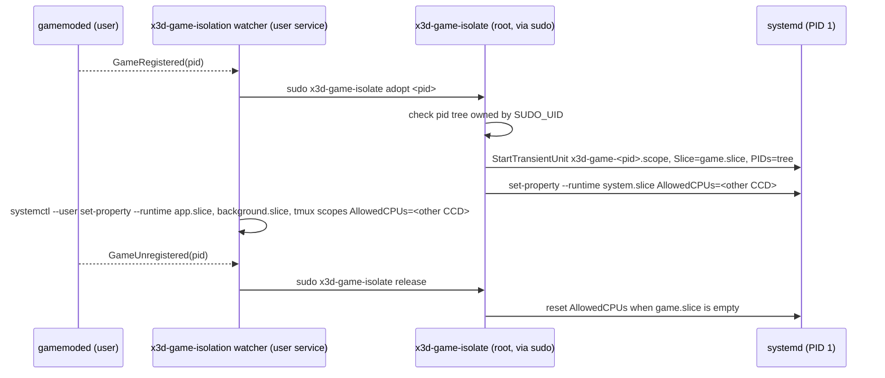

# X3D game isolation: the game owns the cache CCD while it runs

## Goal

While a game runs on a dual-CCD X3D host, only the game and the compositor run
on the V-Cache CCD: system services (nix builds, Ollama) and the session's
dev work (tmux, agents, apps) move to the other CCD and keep running. When no
game runs, nothing changes.

Driving case: demon (9950X3D, cache CCD `0-7,16-23`), Rocket League hitching
while nix builds, Ollama and dev work run in the background.

## Non-goals

- GPU contention. NVIDIA has no per-process GPU priority on Linux; Ollama
  generating still competes with the game.
- Parking the other CCD (gamemode `park_cores`). It wins FPS by taking the
  background's cores away, which is the opposite of the goal.
- Single-CCD or uniform-cache CPUs. The feature does nothing there.

## Current state

Measured on demon with Rocket League in a match:

| Finding | Evidence |
|---|---|
| gamemode's renice is a no-op against other cgroups | game cgroup stalled on CPU 13.5% of the time at `nice -5`; [gamemode#437](https://github.com/FeralInteractive/gamemode/issues/437) is open since 2023 |
| `app.slice` lost to 25 `tmux-spawn-*` sibling scopes at equal weight | stall fell to 4% with `app.slice`/`app-graphical.slice` at `CPUWeight=10000` |
| half of the game's memory sat in zram | `VmSwap` 4.1 GB vs `VmRSS` 3.8 GB, swappiness 180 |
| gamemode `pin_cores` confines the game, not its neighbours | nix-daemon Java and tmux pytest kept running on CPUs 0-7,16-23 |

Already landed: `user.slice` `MemoryLow` in `hosts/nixos/demon/memory.nix`.
Rejected: `CPUWeight=10000` on the user `app.slice`/`app-graphical.slice`. It
cut the stall to 4%, but those slices also hold Discord, browsers, Slack and,
since a tmux restart, new tmux panes, so it boosted most of the desktop rather
than the game.

Manual trial of this design (Rocket League adopted by its Proton prefix into
`game.slice`, `CPUWeight=10000`, cache CCD): average FPS good. With `user.slice`
also confined to the other CCD, 1% lows dropped by feel; giving `user.slice` all
cores back improved them, so the compositor needs the cache CCD too.

MangoHud frame-time logs, Free Play, runs taken back to back. Stress is 32
`stress-ng --cpu-method matrixprod` workers in the user session; Ollama idle.

| Run | Setup | Load | Avg | p99 | p99.9 | Frames >33 ms/min |
|---|---|---|---|---|---|---|
| A3 | baseline + stress | 102 | 19.1 ms | 75.5 ms | 182 ms | 214 |
| B2 | `game.slice` + `system.slice` confined + stress | 108 | 3.00 ms | 11.0 ms | 87 ms | 61 |
| B5 | B2 + `app.slice` `CPUWeight=idle` | ~135 | 2.71 ms | 10.6 ms | 90 ms | 74 |
| B6 | B2 with stress pinned to the other CCD | ~135 | 2.21 ms | 5.3 ms | 28 ms | 25 |

Per-second run-queue wait of `RenderingThread` was 228 ms/s in B2-style runs,
170 in B5 and 75 in B6. Priority barely moves p99; keeping the work off the
cache CCD halves it, because work there shares the game's SMT cores and V-Cache
whatever its weight.

## Design



### Units

- **`game.slice`** (system, top-level): `AllowedCPUs` = cache CCD and
  `CPUWeight=10000`. Top-level, so its weight competes directly with
  `user.slice` and `system.slice` (100 each) instead of with tmux scopes inside
  the session. The weight matters only while a game scope is in it, so it
  boosts the game and nothing else.
- **`system.slice`** gets `AllowedCPUs` = other CCD while a game runs.
- **`user.slice`** keeps all cores, so `session.slice` (Hyprland) keeps the
  cache CCD; confining the whole session cost 1% lows.
- **Inside the session**, `app.slice`, `background.slice` and every
  `tmux-spawn-*` scope directly under the user manager get `AllowedCPUs` =
  other CCD. This needs `Delegate=cpu cpuset io memory pids` on `user@.service`;
  today the user manager gets only `cpu memory pids`.
- **The Steam client's unit is never confined.** The game calls into it every
  frame (overlay, Steam API); starved on the busy CCD it added hitches (C2 vs C3
  below).

Real dev load (~80), no stress, game in `game.slice`, `system.slice` confined,
session confinement approximated with `taskset`:

| Run | Session processes | Avg | p99 | p99.9 | Frames >33 ms/min | Render wait |
|---|---|---|---|---|---|---|
| C1 | all cores | 2.06 ms | 4.29 ms | 10.1 ms | 4 | 65 ms/s |
| C2 | other CCD, Steam client too | 1.85 ms | 3.42 ms | 15.7 ms | 17 | 7 ms/s |
| C3 | other CCD, Steam client all cores | 1.91 ms | 3.18 ms | 4.6 ms | 0 | 12 ms/s |

- **`x3d-game-<pid>.scope`**: created per game, adopting the game's existing
  processes; anything the game spawns later follows by cgroup inheritance.
  systemd cannot move a process into an existing unit, but a new scope can
  adopt running PIDs, as `systemd-run --scope` and logind do.

### Watcher (user service)

Follows `GameRegistered`/`GameUnregistered` on gamemode's session D-Bus, the
same pattern as `gpu-worker-game-guard`, and reconciles from `ListGames` at
start and when gamemoded restarts. Not gamemode's `custom.start`: that fires
only on the first client (0→1), so a second game would be missed.

### Root helper `x3d-game-isolate`

Interface, the only commands sudo allows for the `gamemode` group:

```
x3d-game-isolate adopt <pid>   # adopt <pid>'s game into game.slice, confine system.slice
x3d-game-isolate release       # if game.slice is empty, give every slice all CPUs back
```

- Reads the CCD split from L3 sizes in `/sys/devices/system/cpu/cpu*/cache/index3/`;
  uniform sizes mean exit 0 without changes.
- Refuses any PID in the tree whose real UID is not `SUDO_UID`.
- Never runs a command: it only adopts existing processes and sets slice properties.
- Every change is `--runtime`, so a reboot clears a stuck state.

### Where it lives

`hosts/common/optional/nixos/gaming/x3d-game-isolation/` — `default.nix`
(slice, sudo rule, user service), the helper and watcher scripts, `tests/`.
Imported by demon only. A gaming-suite module, because it is about games, not
demon.

## Alternatives considered

| Alternative | Rejected because |
|---|---|
| Always pin nix-daemon and Ollama to the other CCD | halves their CPU when not gaming |
| Delegate `cpuset` alone, game stays in the session | the game's ancestors must keep the cache CCD, so siblings started beside them escape; now used alongside `game.slice` instead, where only the session's own units are confined |
| `CPUWeight=idle` on the session's dev work | B5: p99 unchanged at 10.6 ms; shared cores and cache, not CPU time, cost the frames |
| Polkit rule letting `gamemode` start `x3d-game-*.scope` | polkit sees only the unit name and verb, and `unit_pid_attachable` checks no ownership: any process running as the user could adopt root's processes into a scope with a 1 s runtime or tiny `MemoryMax`, a local DoS |
| sudo launch wrapper in Steam launch options | sudo resets the environment, so the game loses Wayland and Steam runtime variables; preserving them feeds user env into a root process |
| gamemode `park_cores` | takes the other CCD offline; background work shares the game's cores |
| x3d-pinner / X3Dctl | per-process affinity by name; unnamed new work falls through |

## Security

The sudo rule grants exactly the two helper commands. What a compromised
process running as the user gains: moving its own processes onto the cache
CCD, and confining system services to the other CCD until `release` or reboot.
They keep running; nothing gains code execution or access to another user's
processes.

## Open questions

- Which processes form "the game". The trial adopted every process whose
  environment names the prefix (`STEAM_COMPAT_DATA_PATH`), 23 of them from
  Steam's `reaper` to `wineserver`. The helper cannot read environments to
  decide ownership safely; the likely rule is the descendants of the gamemode
  client's `reaper` ancestor. Confirm `wineserver` is among them.
- Who confines the session's units: the watcher (a user service, no sudo once
  `cpuset` is delegated) or the root helper. Units started mid-game directly
  under the user manager escape until the next `adopt`; new tmux scopes now land
  in `app.slice`, which is confined.
- gamemode's own `pin_cores` becomes redundant once the scope carries
  `AllowedCPUs`; turn it off or leave it.

## Risks

- A watcher crash between `adopt` and `release` leaves slices confined. The
  watcher reconciles from `ListGames` on restart; a reboot clears it too.
- System services and dev work share 16 threads during games; builds, tests
  and agents run slower while playing.

## Addendum: as built (supersedes the design above where they differ)

Decision record: [ADR 0027](../../adr/0027-a-running-game-owns-v-cache-cores-sized-to-its-load.md),
including the measurements that chose this shape.

- **The game** moves into `game.slice` inside the user's session (weight 10000):
  every process in Steam's per-game `app-steam-app<id>-*.scope`, or else the
  gamemode client and its descendants. Its threads join resctrl's `game` group,
  which holds three quarters of the V-Cache L3 ways.
- **Its cores** start at 4 physical V-Cache cores with their SMT siblings and
  are sized on at least 5 s of load: one more while its cores run over 85%
  busy or its threads wait over 5% (`cpu.pressure`), one fewer while it would
  stay under 70% with one less, never past the V-Cache CCD. A resize starts a
  new window, and the game's threads are pinned to exactly its cores whenever
  they change, since a gamemode pin taken under another fence would keep them
  off the new ones (a one-second window thrashed between 4 and 7 cores).
- **Everything else** gets every other CPU: the root helper fences
  `system.slice` and `init.scope` and splits the L3; the watcher fences every
  direct child of the user manager except `session.slice` (Hyprland, and the
  Steam client it moves into `session-graphical.slice`) and `game.slice`.
- **The watcher** reconciles at start and on each gamemode signal; while
  playing it re-sizes every second, otherwise it sleeps until a signal. It
  holds the split while the game's processes outlive its registration and
  releases everything on service stop. Its only file is the game's last CPU
  usage sample; fences are read back from `cpuset.cpus`.
- Tests: `x3d-game-isolation/tests/` (CPU lists via the CCD detector, the
  helper, the watcher's passes and sizing), all against fakes.
- **Security** (supersedes the section above): sudo lets the `gamemode` group
  run `x3d-game-isolate split <cpus>` and `release` only. The helper refuses any
  list that is not ascending ranges of CPUs below 4096 lying within the V-Cache
  CCD, so the worst a process running as the user can do is move system
  services to the other CCD and shrink the default group's L3 share until the
  next `release`. Adding threads to the cache group goes through the kernel,
  which only lets a user move their own threads.
